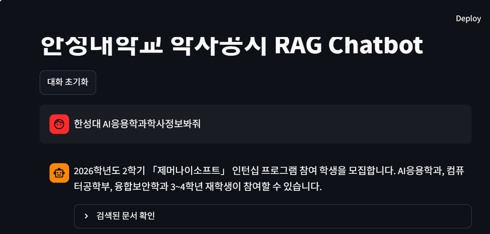

# 7주차 실행 결과

실행 환경: Windows 11, Python 3.12.10, Ollama 0.40.3, gemma3:4b

```
cd C:\2026-open\7w
.\.venv\Scripts\Activate.ps1
```

---

## STEP 1. Ollama 연결 확인

```
python step1_ollama.py
```

```
질문:
RAG가 무엇인지 한 문장으로 설명해줘.

답변:
RAG(Retrieval-Augmented Generation)은 검색된 정보를 활용하여 생성 모델의 답변 품질을 향상시키는 기술입니다.
```

---

## STEP 2. 관련 문서 검색

```
python step2_retrieval.py
```

```
데이터 폴더:
C:\2026-open\6w\data

문서 불러오기: 공지1.pdf

문서 불러오기: 공지2.pdf

불러온 전체 페이지 수: 4

생성된 Chunk 수: 8

질문:
인턴십 관련 공지의 주요 내용은 무엇인가요?

========== 검색 결과 1 ==========
파일: 공지2.pdf
페이지: 0

문서 내용:
단축 URL
SW중심대학사업단에서 2026학년도 2학기 「제머나이소프트」 인턴십 프로그램 참여 학생을 모집합니다. 관심 있는 학생들의 많은 참여 바랍니다.

1. 참여대상
- 한성대학교 3~4학년 재학생 중 SW학과 재학생
...
2. 모집개요
- 기업명: 제머나이소프트(서울특별시 마포구 월드컵북로 402, 상암동 케이지아이티센터)
- 모집인원: 4명
...

========== 검색 결과 2 ==========
파일: 공지2.pdf
페이지: 0

문서 내용:
면접 전형 2026.10.26.(월)
최종 합격자 통보 2026.10.29.(목) 개별 통보
인턴십 기간 2026.11.02.(월) ~ 2026.12.11.(금) 총 30일
...
6. 제출서류
- 제출서류: 이력서(붙임) 1부(포트폴리오 별도 첨부 가능)
- 제출처: sw_center@hansung.kr
...

========== 검색 결과 3 ==========
파일: 공지2.pdf
페이지: 0

문서 내용:
2주차 현황 분석 및 개선과제 발굴
...
4. 학생 혜택
- 1인당 실습지원비: 80만원(학교에서 지급)
- 비교과 포인트 20P 지급
...
5. 운영 일정
모집기간(이력서 제출) 2026.10.01.(목) ~ 2026.10.18.(일)
...
```

검색 결과 3개 모두 인턴십 공지(공지2.pdf)에서 나왔다.

---

## STEP 3. Basic RAG

```
python step3_basic_rag.py
```

```
========== 검색된 실제 내용 ==========

[검색 결과 1]
파일: 공지2.pdf
페이지: 0
면접 전형 2026.10.26.(월)
최종 합격자 통보 2026.10.29.(목) 개별 통보
인턴십 기간 2026.11.02.(월) ~ 2026.12.11.(금) 총 30일
...

[검색 결과 2]
파일: 공지1.pdf
페이지: 0
4. 이력서 제출기한: ~ 2026년 10월 7일(수),  22:00까지 (제출메일은 기업배정 시 문자로 개별 안내 예정)
...

[검색 결과 3]
파일: 공지1.pdf
페이지: 0
단축 URL
2027년 IPP 일학습병행(SW개발) 참여 학생  2차 모집
...
3. 신청서 제출기한: ~ 2026년 10월 7일(수), 오전 11:00까지
4. 이력서 제출기한: ~ 2026년 10월 7일(수),  22:00까지
======================================
질문:
인턴십 신청 기간은 언제인가요?

검색된 문서:
- 공지2.pdf
- 공지1.pdf
- 공지1.pdf

RAG 답변:
2026년 10월 7일(수) 22:00까지입니다.
```

답변이 틀렸다. 제머나이소프트 인턴십 모집기간은 2026.10.01 ~ 10.18 인데,
이 내용이 있는 Chunk가 검색 상위 3개에 안 들어갔고 대신 공지1(IPP 일학습병행)의 이력서 제출기한이 검색돼서 그걸로 답했다.
프롬프트를 잘 써도 검색이 잘못되면 답도 틀린다는 걸 확인함. k 값을 늘리거나 질문을 더 구체적으로 하면 나아질 것 같다.

---

## STEP 4. 대화형 RAG

```
python step4_chat_rag.py
```

```
대화형 RAG Chatbot
종료하려면 exit를 입력하세요.

사용자: 제머나이소프트 인턴십 모집인원은 몇 명이야?

[검색 Query]
제머나이소프트 인턴십 모집인원은 몇 명이야?

AI: 제머나이소프트 인턴십 모집인원은 4명입니다.

사용자: 그럼 제출처는 어디야?

[검색 Query]

이전 질문:
제머나이소프트 인턴십 모집인원은 몇 명이야?

현재 질문:
그럼 제출처는 어디야?


AI: 제출처는 sw_center@hansung.kr 입니다.

사용자: exit
```

두 번째 질문에는 "인턴십"이라는 말이 없는데도 이전 질문이 검색 Query에 같이 들어가서 맞는 답이 나왔다.

---

## STEP 5. Streamlit Chat UI

```
streamlit run app.py
```

브라우저에서 http://localhost:8501 접속

```
사용자: 한성대 AI응용학과학사정보봐줘

AI: 2026학년도 2학기 「제머나이소프트」 인턴십 프로그램 참여 학생을 모집합니다. AI응용학과, 컴퓨터공학부, 융합보안학과 3~4학년 재학생이 참여할 수 있습니다.
```



데이터가 인턴십 공지 2개뿐이라 학사정보 전체가 아니라 "AI응용학과"가 들어간 공지2 내용으로 답했다.
답변 아래 "검색된 문서 확인"을 펼치면 검색 Query랑 검색된 문서 내용을 볼 수 있다.
